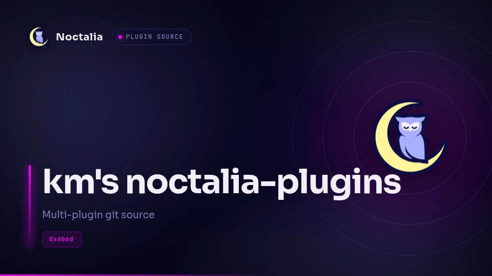

# noctalia-plugins

[](https://github.com/0x6b6d/noctalia-plugins/actions/workflows/validate.yml)
[](./LICENSE)
[](https://github.com/noctalia-dev/noctalia)



Personal plugin source for [Noctalia](https://github.com/noctalia-dev/noctalia) v5.

This repository is a **multi-plugin git/path source**: add it once in Noctalia,
then enable any plugin it ships. Layout follows the same model as
[community-plugins](https://github.com/noctalia-dev/community-plugins)
(one directory per plugin + root `catalog.toml`), kept intentionally lean for
solo maintenance.

> **Not** the official community store. Plugins here are maintained for personal
> use; install by adding this repo as a source (see below). Contributions are
> welcome, but there is no store PR pipeline.

## Quick start

Requires a running Noctalia v5 shell.

```sh
# Add this repository as a plugin source
noctalia msg plugins source add personal git https://github.com/0x6b6d/noctalia-plugins.git

# Or develop from a local checkout
noctalia msg plugins source add personal path /path/to/noctalia-plugins

# Enable a plugin
noctalia msg plugins enable kurai/<plugin>
```

Then place the bar widget from the bar editor.

List sources / plugins:

```sh
noctalia msg plugins source list
noctalia msg plugins list
```

## Plugins

| Plugin | ID | Description |
| --- | --- | --- |
| [taskwarrior](./taskwarrior/) | `kurai/taskwarrior` | Widget + Panel UI for taskwarrior |


Each plugin has its own `README.md` with settings, dependencies, and IPC.

## Repository layout

```text
noctalia-plugins/
├── catalog.toml                 # source index (generated / kept in sync)
├── README.md
├── .github/
│   ├── scripts/                 # validate + catalog tools
│   └── workflows/               # CI
└── taskwarrior/                 # id: kurai/taskwarrior
```

Rules of thumb:

- Directory name = the segment of the plugin id after `/`
- `plugin.toml` is authoritative; `catalog.toml` is for discovery/compat listing
- `.luau` hot-reloads when enabled; **manifest changes** need disable+enable

## Development

### Prerequisites

- [Noctalia](https://github.com/noctalia-dev/noctalia) v5 (plugin API 3+)
- `python3` (for local checks)
- Optional: [`luau-lsp`](https://github.com/JohnnyMorganz/luau-lsp) + editor config in-repo

### Clone and use as a path source

```sh
git clone https://github.com/0x6b6d/noctalia-plugins.git
cd noctalia-plugins

noctalia msg plugins source add personal path "$(pwd)"
noctalia msg plugins enable kurai/<plugin>
```

### Editor types

`noctalia.d.luau` is **not** vendored (same policy as community-plugins). Fetch
into the repo root when you want IDE completions:

```sh
curl -O https://raw.githubusercontent.com/noctalia-dev/official-plugins/main/noctalia.d.luau
```

Workspace configs are included for:

- VS Code / Cursor (`.vscode/`)

### Local checks

```sh
# rebuild catalog.toml from each plugin.toml
python3 .github/scripts/update_catalog.py

# manifest / entries / translation keys
python3 .github/scripts/validate_plugins.py

# official offline lint (getConfig vs declared settings)
noctalia plugins lint .
```

### Adding another plugin

1. Create `your-plugin/` with a valid `plugin.toml` (id `kurai/your-plugin`).
2. Run `python3 .github/scripts/update_catalog.py`.
3. Run `python3 .github/scripts/validate_plugins.py` and fix any errors.
4. Commit and push; CI will re-validate on GitHub.

## Continuous integration

Lean workflows inspired by community-plugins (no store/PR bureaucracy):

| Workflow | When | What |
| --- | --- | --- |
| [Validate plugins](.github/workflows/validate.yml) | push / PR | `validate_plugins.py` |
| [Update catalog](.github/workflows/update-catalog.yml) | push to `main` | regenerate `catalog.toml` if needed |

## Documentation

- [Noctalia v5 plugin development](https://docs.noctalia.dev/v5/plugins/development/)
- [Workflow & publishing](https://docs.noctalia.dev/v5/plugins/development/workflow/)
- [Runtime API](https://docs.noctalia.dev/v5/plugins/development/runtime-api/)
- [Official plugins](https://github.com/noctalia-dev/official-plugins) (API types + examples)
- [Community plugins](https://github.com/noctalia-dev/community-plugins) (public store source)

## Acknowledgements

This repository's structure and tooling are adapted from other people's work:

- The README layout, the `.github/` workflows and scripts, and the `.vscode/`
  editor config are adapted from
  [OHMCFXG/noctalia-plugins](https://github.com/OHMCFXG/noctalia-plugins),
  and modified for this repo.
- That repo in turn follows the model of Noctalia's
  [community-plugins](https://github.com/noctalia-dev/community-plugins),
  on which the catalog tooling is based.

Thanks to both for the groundwork.

## License

This repository and all plugins in it are released under the [MIT License](./LICENSE),
unless a file states otherwise. Files adapted from other projects are credited
in the [Acknowledgements](#acknowledgements).

## Disclaimer

Noctalia’s plugin system is still evolving. Manifest fields and host APIs may
change before v5 is fully stable — expect occasional bumps when upgrading the
shell.