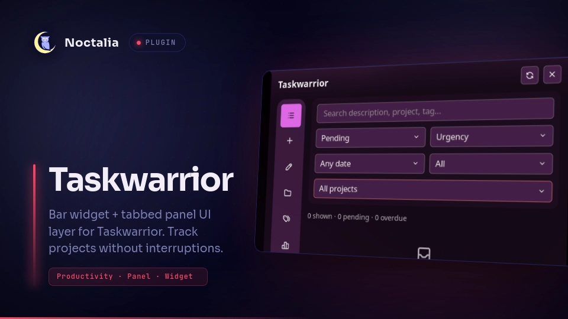

# Taskwarrior

Bar widget + tabbed panel UI layer for [Taskwarrior](https://taskwarrior.org/) (`task`).
Track projects from the bar, triage with filters, and edit tasks with notes without interruptions.



## Plugin

| Field | Value |
| --- | --- |
| ID | `kurai/taskwarrior` |
| Entries | Bar widget: `bar`; service: `sync`; panel: `tasks` |
| Minimum Noctalia plugin API | `26` |

## Requirements

* `task` (Taskwarrior 3.x) on `PATH`.

## Features

* **Composable bar widget**: glyph, primary/overdue/active/today pills, next-task text, and refresh — each toggled separately, plus project tracking with auto-fallback.
* **Six-tab panel**: filterable task list, quick-add with notes, full detail editor, projects with star-to-track, tags, and per-project stats.
* **Safe by default**: two-step delete, setup that refuses to overwrite a real rc file, honest sync and undo labeling.

## Usage

1. Enable the plugin, add the `bar` widget to your bar (`type = "kurai/taskwarrior:bar"`).
2. Click the widget to toggle the panel. Right-click opens the Add tab directly (both targets are configurable).
3. Tabs: **Tasks** (filter/sort, tap a row to edit, dots for quick actions), **Add** (with optional note), **Edit** (detail editor, notes, start/stop, done/delete), **Projects** (star tracks a project in the widget), **Tags**, **Stats** (per-project scope, completion graph, waiting/today, oldest).
4. If no rc file exists the panel shows a setup view with auto-init (creates rc + data dir) or terminal fallback. Initialize refuses to overwrite a non-empty rc file.

Scrolling on the widget cycles the primary count. On vertical bars the widget stacks instead of spreading. `ctrl+n` jumps to the Add tab while the panel is focused.

Delete is two-step (tap again within 8s to confirm) and lives only in the Edit tab. Undo reverts the last change from any source, including CLI and sync.

Mutations use stable UUIDs with `rc.confirmation=no`. The service re-exports `(status:pending or status:waiting)` on `poll_seconds` and, every 4th poll, a 14-day completed window plus totals; panels refresh immediately after writes and via `refreshReq` state.

## Settings

### Plugin

| Setting | Type | Default | Description |
| --- | --- | --- | --- |
| `task_bin` | `string` | `task` | Task executable. |
| `taskrc_path` | `string` | `` | Alternate rc (`rc:<path>`); empty = `~/.taskrc`/`$TASKRC`. |
| `data_location` | `string` | `` | Data dir offered at init; empty = `~/.task`. |
| `poll_seconds` | `int` | `15` | Service export interval in seconds (5–300). |
| `badge_mode` | `select` | `pending` | Widget badge: pending/overdue/active/today. Scroll on widget cycles it. |
| `show_completed` | `bool` | `false` | Default list filter includes completed tasks. |
| `project_filter` | `string` | `` | Widget tracks one project (empty = all). Unknown names fall back to all. |

### Bar Widget

| Setting | Type | Default | Description |
| --- | --- | --- | --- |
| `show_glyph` | `bool` | `true` | Icon before the count. |
| `glyph` | `glyph` | `checklist` | Glyph shown when nothing is overdue. |
| `show_count` | `bool` | `true` | Count badge; off = icon-only button. |
| `show_overdue` | `bool` | `false` | Extra overdue pill (only while > 0). |
| `show_active` | `bool` | `false` | Extra started-tasks pill. |
| `show_today` | `bool` | `false` | Extra due-today pill. |
| `show_next_task` | `bool` | `false` | Inline next-task text, truncated to fit. |
| `show_refresh` | `bool` | `true` | Inline refresh button. |
| `use_overdue_glyph` | `bool` | `true` | Auto-swap icon while overdue. |
| `overdue_glyph` | `glyph` | `alert-triangle` | Glyph shown while anything is overdue. |
| `highlight_overdue` | `bool` | `true` | Red badge tint while overdue. |
| `hide_when_empty` | `bool` | `false` | Hide widget while count is zero. |
| `click_tab` | `select` | `tasks` | Which tab a left click opens (`tasks`, `add`). |
| `right_click_tab` | `select` | `add` | Which tab a right click opens (`tasks`, `add`). |
| `show_next_in_tooltip` | `bool` | `true` | Next-task row in tooltip. |

## Tracking

The bar widget counts one project (`project_filter`, empty = all). In the
panel's **Projects** tab the star tracks a project at runtime: star a project
to track it, star again to revert to settings, star **All projects** to track
everything. Overrides persist across restarts. A settings-pinned project can't
be unstarred from the panel (change it in settings).

## IPC

```sh
noctalia msg plugin kurai/taskwarrior:sync all refresh    # re-export now
noctalia msg plugin kurai/taskwarrior:bar focused refresh # same, via widget
noctalia msg plugin kurai/taskwarrior:tasks all tab add   # switch panel tab
noctalia msg panel-toggle kurai/taskwarrior:tasks         # open/close panel
```

## Notes

* Processes: every read is a `task … export`/`count`/`_config` call; writes are `add`, `modify`, `done`, `delete`, `start`/`stop`, `annotate`/`denotate`, `sync`, `undo`. No daemons, no network calls of its own.
* Files: reads your task database through the CLI only. Writes `tracked.json` (widget project tracking) under `pluginDataDir`, and writes `~/.taskrc` plus the data dir **only** via the Setup tab's Initialize button — never on a non-empty rc file.
* Privacy: no credentials are ever touched and task content never leaves your machine; there is no account, telemetry, or network traffic.
* Starting a timer on a completed task reopens it (upstream behavior); the UI hides Start there to prevent accidents.

## Limitations

* Local databases only: sync needs a replica configured (see `task-sync(5)`), otherwise the Sync button reports that there is nothing to do.
* The panel is a fixed 520×520 surface; long lists scroll, and text follows the shell UI scale.
* Opening the panel fetches the full completed history for per-project progress, so very large histories take a beat on open. Background polling stays on the lightweight 14-day window.

## Troubleshooting

* **Widget shows `!`**: the backend error is in its tooltip. `Task binary not found` means `task` is missing from `PATH`.
* **`Cannot proceed without rc file`**: the panel offers one-click Initialize, or point `taskrc_path` at an existing file.
* **A different backend error** (lock, parse error, version mismatch): auto-setup stays disabled to protect your config — use Retry or the terminal button.
* **Counts look frozen**: the service polls on `poll_seconds`; the widget/panel refresh buttons and the IPC `refresh` event update immediately.
* **A tracked project shows everything**: the name doesn't match any pending project (check spelling), so it falls back to all tasks — see the tooltip note.

## Plugin layout

```text
.
├── lib
│   ├── export.luau
│   ├── panel_ops.luau
│   ├── panel_state.luau
│   ├── panel_ui.luau
│   ├── tabs
│   │   ├── add.luau
│   │   ├── edit.luau
│   │   ├── projects.luau
│   │   ├── setup.luau
│   │   ├── stats.luau
│   │   ├── tags.luau
│   │   └── tasks.luau
│   └── task.luau
├── README.md
├── thumbnail.webp
├── plugin.toml
├── panel.luau
├── service.luau
├── widget.luau
└── translations
    └── en.json
```

## Layout

* `widget.luau` — bar badge; `service.luau` — export poll → shared state.
* `panel.luau` — thin entry: render shell, `onOpen/onClose/onKey`, watches.
* `lib/task.luau` — pure task helpers (filter/sort/facets/argv).
* `lib/panel_state.luau` — the one shared state table all panel modules use.
* `lib/panel_ops.luau` — all `task` subprocess calls + form submit logic.
* `lib/export.luau` — shared export readers (pending, 14d window, totals, full) used by service + panel.
* `lib/panel_ui.luau` — section/tab-rail/footer/stat primitives (styling lives here).
* `lib/tabs/<tasks|add|edit|projects|tags|stats|setup>.luau` — one view module per tab.
